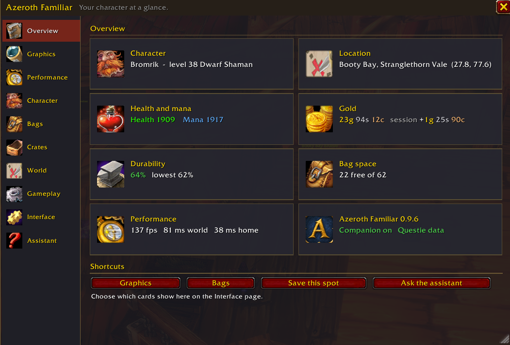
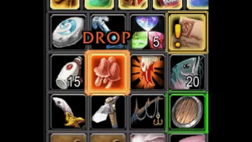
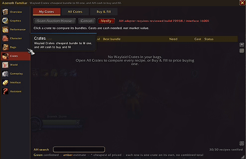
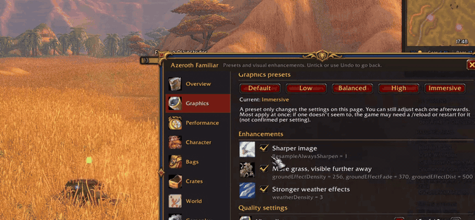
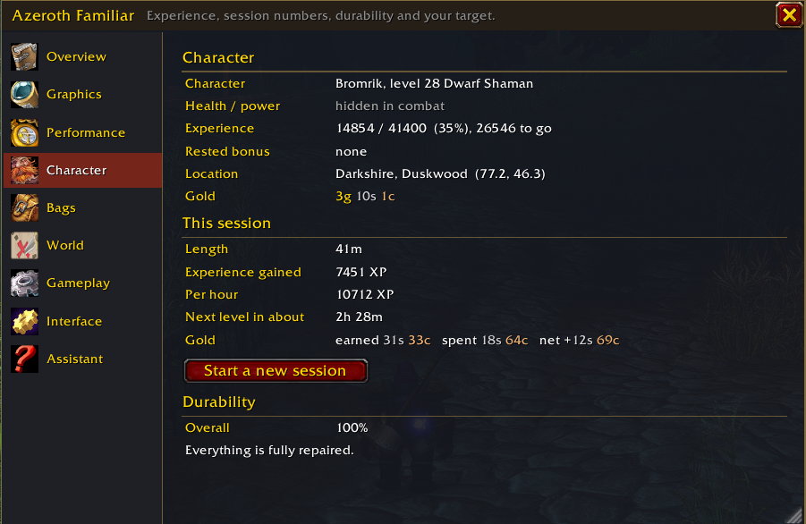
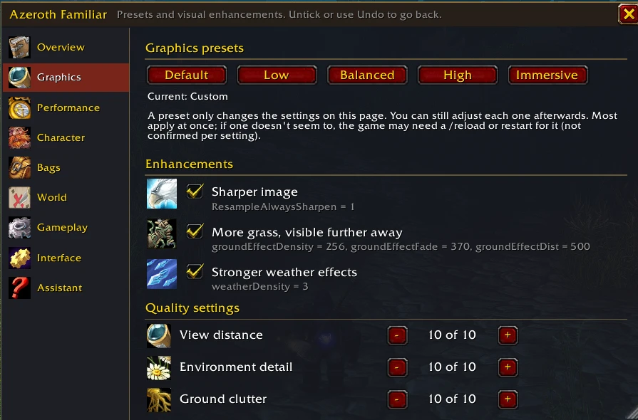
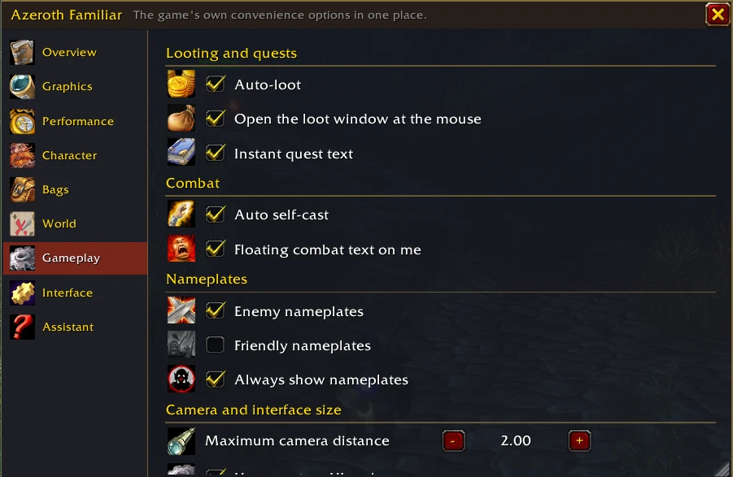

# Azeroth Familiar

**Your all-in-one sidekick for World of Warcraft: Forever.** One window for everything you reach for every session: graphics presets, XP per hour, a "what do I drop?" helper for full bags, a Waylaid Crate planner with live auction prices, and an assistant that answers item and quest questions in plain English.

*Formerly Azeroth Assistant.* The addon folder is still `AzerothAssistant`, so saved settings, the minimap button position and the desktop companion keep working after the rename.

[Download on CurseForge](CURSEFORGE_LINK) · [Report a bug](https://github.com/xdsliperz1830-eng/azeroth-familiar/issues) · MIT licensed

<!-- MEDIA SLOTS: each "🎬" line marks a spot for a GIF or video. To fill one: record it,
     save it in screenshots/ under the suggested name, delete the "> 🎬" line and remove the
     comment marks around the image line below it. Keep GIFs under ~10 MB (GitHub's limit)
     and around 800 px wide. -->

> 🎬 **Video slot: 30-second tour** (open the window, flip through the pages). Upload to YouTube and put the link here.
<!-- [](YOUTUBE_LINK) -->


## Highlights

### Bags full? Know what to drop
When you loot with full bags, the cheapest stack in your bags gets a pulsing red **DROP** label, the bags open so you can see it, and its tooltip says what it's worth. "Cheapest" uses the vendor price, or the **Auctionator** price when that is higher, so ore and herbs that sell well aren't picked. Quest items, your hearthstone and profession tools (skinning knife, mining pick, fishing pole) are never picked. Works with the default bags and **Bagnon**. It only points; it never sells or deletes anything.



### Waylaid Crates: the cheapest way to fill each crate
The **Crates** page lists your crates (**My Crates**), every known recipe (**All Crates**) and the cost of buying an empty crate and filling it (**Buy & Fill**). Each accepted bundle is priced from the materials you own plus a manual **Auction House scan** (or Auctionator's cached prices), so you see the cash needed per crate. Hovering a crate highlights its cheapest bundle in green right in the tooltip (amber for cached estimates). It never buys or opens anything. Details in [docs/CRATES.md](docs/CRATES.md).



### One-click graphics presets, with undo
Five presets (**Default, Low, Balanced, High, Immersive**), three extras (**sharper image**, **more grass further away**, **stronger weather**) and the game's quality sliders with – / + buttons. Each slider learns this client's real maximum. Your original settings are remembered and one button puts them all back.

> 🎬 **GIF slot: Graphics presets** (click Low, then Immersive; the world changes behind the window). Save as `screenshots/graphics.gif`.
<!--  -->

### Ask in plain English
- "is this an upgrade?" with an item link: stat differences against what you're wearing
- "which is better for me?" with two item links: a side-by-side comparison
- "where can I get [item]?": vendors, drops and quest rewards with coordinates (uses **Questie**)
- a quest link plus "where do I go?": objectives, progress, quest giver and turn-in
- its own **Assistant chat tab**, which never posts to public chat

Every answer says where it came from. Answers with web sources come from the optional **Azeroth Companion** desktop app, which is separate from the addon.

> 🎬 **GIF slot: Assistant** (type "where can I get Linen Cloth?" and the answer appears). Save as `screenshots/assistant.gif`.
<!--  -->

### Character and session
XP and time to next level, **XP per hour**, rested bonus, gold earned / spent / net this session, and durability per item. The Overview card shows your health and mana in colour and a portrait matching your race and gender.



### Also included
- **World:** coordinates, saved places, and a map pin where the game supports it
- **Gameplay:** the game's own convenience options in one place (auto-loot, instant quest text, nameplates, camera distance, UI scale…)
- **Performance:** frame rate, latency, plain-language tips and an optional on-screen FPS readout
- **Reminders:** optional chat notes for low durability, nearly full bags, vendor greys and repair cost, and a level-up summary
- **A proper frame:** gold and gem border around the window and its dialogs




## Pages
| Page | What it does |
|---|---|
| Overview | Cards for character, location, health/mana, gold, durability, bag space, performance and addon status, plus shortcuts. |
| Graphics | Five presets, three enhancements and the game's quality sliders (each learns this client's real maximum). Remembers your earlier values; one button restores them. |
| Performance | Frame rate, average, latency, session length, plain advice, optional on-screen readout, addon memory on request. |
| Character | Experience and rested bonus, session experience and gold, durability by item, target summary. |
| Bags | Free slots, gold, grey items with vendor value, bag search, and the DROP mark when looting with full bags (default bags and Bagnon; Auctionator prices count). Never sells or deletes anything. |
| Crates | Waylaid Crate planner (formerly the Crate Scout addon): My Crates, All Crates and Buy & Fill, priced from owned materials and a manual Auction House scan, plus tooltip highlighting of the cheapest bundle. See `docs/CRATES.md`. Never buys or opens anything. |
| World | Zone and coordinates, saved places, map pin (when the client supports it), copy box. |
| Gameplay | The game's own convenience options: auto-loot, instant quest text, nameplates, camera distance, UI scale and more. |
| Interface | Window size, opacity, compact navigation, start page, Overview cards, chat reminders, resets. |
| Assistant | The item/quest/bag assistant, with the optional desktop companion. |

Commands: `/fam` (open), `/fam graphics`, `/fam perf`, `/fam character`, `/fam bags`, `/fam crates` (also `/fam crates verify`, `/fam crates cancel`, and the old `/cratescout`), `/fam world`, `/fam gameplay`, `/fam interface`, `/fam assistant`, `/fam pin <name>`, `/fam fps`, `/fam diag`, `/fam help`. `/familiar` and the old `/aa` work the same way.

## Works with (all optional)
- **Questie:** vendor, drop, NPC and quest-location answers
- **Auctionator:** auction prices for the DROP mark and cached crate prices
- **Bagnon:** the DROP mark shows in Bagnon's bags

## What it will not do
No selling, buying, repairing, looting, targeting, casting or message sending. Game settings change only when you click, never in combat, and each change is read back from the game. Health and mana are hidden from addons during combat on this client, so there are no low-health reminders.

## Status
Tested in a simulated client and partly in the real game. Game setting names were checked against this install's `Config.wtf`; the upper limits of the quality sliders and all Gameplay options are checked at run time (missing ones are greyed out). See `TESTING.md`.

## Files
`Core.lua` (namespace, saved data, events, slash commands, diagnostics), `Tweaks.lua` (game-settings engine), `Modules/Stats.lua` (read-only facts and session tracking), `Modules/Reminders.lua`, `Modules/BagHint.lua` (what-to-drop mark when looting with full bags), `Crates/` (crate recipes, tooltip validation, AH scanner, cost engine and tooltip highlight; page in `Modules/Crates.lua`), `UI/Widgets.lua` (shared controls), `UI/Shell.lua` (navigation and page host), `UI.lua` (window and Assistant page), one file per page in `Modules/`, and the assistant files (`Assistant.lua`, `Search.lua`, `Compare.lua`, `Quests.lua`, `Context.lua`, `Links.lua`, `Export.lua`, `Companion.lua`, `ChatTab.lua`, `Integrations/`).

---

# Assistant page (earlier documentation)

An in-game helper window for **World of Warcraft: Forever**. Ask about items, quests,
your bags and professions. Answers come from your game client and, if you have
**Questie** installed, from Questie's database (vendors, drops, NPC and quest-giver
locations). For anything else it gives you a **Wowhead Forever link** and an **Ask AI**
packet you can paste into an external assistant such as Claude.

> Status: v0.1.0 loaded and answered questions in game (build 1.60.1.70888, interface 16001,
> all checked APIs present). The v0.2.0 additions (minimap button, Questie lookups, follow-up
> questions) were tested only against a mocked API so far. Run the v0.2.0 section of `TESTING.md`.

---

## Install

1. Close the game (or plan to `/reload` afterwards).
2. Copy the whole `AzerothAssistant` folder into your Forever AddOns folder. The usual path is:
   `C:\Program Files (x86)\World of Warcraft\_forever_\Interface\AddOns\`
   (If WoW is installed elsewhere, use **Battle.net > WoW Forever > gear icon > Show in Explorer**.)
3. The result must look like `...\_forever_\Interface\AddOns\AzerothAssistant\AzerothAssistant.toc`
   (not `AzerothAssistant\AzerothAssistant\...`).
4. Start the game. On the character screen, open **AddOns** and make sure Azeroth Familiar is enabled.
   If it's listed as "out of date", see Troubleshooting.

## Use

| Do this | What you get |
|---|---|
| `/fam`, `/familiar` or `/aa`, or the **minimap button** | Open/close the window. Right-click the button for Settings; drag it to move it. `/aa minimap` hides/shows it |
| Click the input box, then **shift-click** an item in your bags or a quest in your quest log | The link goes into the assistant's box (normal chat linking still works as before) |
| "is this an upgrade?" + one item link | Stat differences against what you have equipped (2H vs main hand + off hand handled) |
| "which is better for me?" + two item links | Side-by-side stat differences, weapon DPS/speed, special effects |
| "search my bags for Medium Leather" | Counts in bags and equipped items |
| quest link + "where do I go?" | Objectives and progress from your log, plus quest giver / turn-in NPC with zone and coordinates (Questie) |
| "where can I get the Sleeping Bag?" (link or exact name) | Vendors (your faction first), creatures that drop it, objects/containers, quest rewards, with zone and coordinates (Questie) |
| "where is Innkeeper Firebrew?" | NPC zone and coordinates (Questie) |
| "what is this for?" right after linking an item | Follow-up about the same item: known recipes and current quests that use it |
| "my quests", "quests wolf" | Quest log overview or search |
| "my professions" | Skill levels and saved recipe lists |
| item link + "what materials do I need?" | Reagents vs. what you carry, **if** you know the recipe and have opened that profession window once |
| "which vendor sells this?" | Questie's vendor list if it has one; otherwise an honest "not listed" + Wowhead link + Ask AI |
| `/aa <question>` | Ask straight from chat |

Every answer starts with a grey label saying where it came from, for example
*(Offline - bags and equipped items, live)* or *(External answer - pasted by you, not verified by the addon)*.

### The Assistant chat tab

On first login, the addon adds an **Assistant** tab to your chat window, next to General and
Combat Log. It shows only the assistant's conversation, never player chat.
- **Ask from it:** select the tab, then click the **"Ask Azeroth Familiar..."** box just below the chat
  lines, type and press Enter. It's the addon's own box, so it can never post to public chat.
  Shift-click items or quests into it too.
- Pressing Enter on that tab also opens WoW's normal chat box already starting with `/fam `, which
  goes to the assistant too.
- **Answers land there:** offline answers and Mrgl's AI answers both appear in the tab, with clickable links.
- **Closed it?** `/aa tab` brings it back. You can also turn it off in Settings ("Assistant tab in the
  chat window"). To remove the tab itself, right-click it and choose Close Window.

### Toolbar

- **Ask AI**: opens one box for the question in the input box (or your last question; the
  **[Ask AI]** link inside answers does the same):
  1. The top half holds a short question, already selected. Click it, press **Ctrl+C**, and paste it into Claude.
  2. Paste the reply into the bottom half (**Ctrl+V**) and click **Show answer**.

  **Send to Companion** (top right of that box) hands the question to the **Azeroth Companion**
  desktop app instead. See "Desktop companion" below.

  The **Include my character** checkbox in that box adds level, gear, stats, professions and
  quests. It's off by default and the text updates as you tick it, so what you see is exactly what
  you copy. Replies show as plain purple text, limited to 4,000 characters / 80 lines, with every `|`
  escape code neutralized.
- **Settings**: minimap button, character sections, your build note, survival-vs-damage preference,
  font size, **Preview** (what "include my character" shares), diagnostics, erase data.
- **Clear**: clears the conversation.

Clicking **[Wowhead: ...]** opens a box with the URL selected. Press Ctrl+C and paste it into your browser.

## Desktop companion (optional)

**Automatic since v0.5.0.** Once the companion has run once, the addon detects it. From then on, any
question the addon can't answer offline goes to the companion when you press Enter. That includes
talent advice, items Questie doesn't know, and general game questions. Start a question with `ai`
(e.g. `ai what talents should I take next?`) to always ask the AI. Answers show in the addon window
**and** in your normal chat window, with clickable sources. Nothing is sent to other players.

**Auto-check (v0.6.2):** after sending, the addon reloads by itself about 25 seconds later to pick
up the answer, and retries twice, 20 seconds apart, if it isn't ready yet. It never does this in
combat; it waits until combat ends. Click **[Don't auto-check]** to skip it once, or turn
"Auto-check for answers" off in Settings.

While an answer is pending, the window shows a **Check for answer** button, the minimap button shows a
green **!**, and Shift+clicking the minimap button checks too. Settings has two switches:
"Ask the companion automatically when I can't answer" and "Show companion answers in the chat window too".

**Azeroth Companion** is a separate Windows app (its own folder and README). It answers questions
with Claude and web search, and the answers appear in this addon's chat:

1. Ask AI, then **Send to Companion**. Your UI reloads, which is when the game saves the question to disk.
2. The companion's murloc says "Answer ready!"
3. Click **[Check for answer]** in the chat, or type `/aa check`. The UI reloads and the answer appears,
   labeled "AI answer via Azeroth Companion", with clickable sources.

The answer file (`CompanionInbox.lua`) contains only data. Every field is type- and length-checked,
and links and color codes in the text are shown literally. Source links only accept `http(s)` URLs.
Questions waiting for an answer are listed after each reload, with a **[Cancel waiting questions]** link.

## Feasibility: what this addon can and can't do

**WoW addons run inside a sandbox.** Verified from the Forever addon community and Blizzard's addon
model:

- No internet: an addon can't call Wowhead, Claude or any HTTPS API, so there's no live AI inside the game.
  (The desktop companion works around this through files and reloads, as described above.)
- No files or processes: it can't read files on your PC or launch programs.
- SavedVariables are only written on `/reload` or logout and only read at login. They're storage, not a live link to outside programs.
- `CopyToClipboard` is restricted on Forever, so copying is done with an edit box and Ctrl+C.
- Midnight-style **secret values** apply on Forever: some unit/combat values can't be read in combat. The addon reads stats only out of combat.

The addon therefore uses three layers:

1. **Offline (built):** bags, equipped items, quest log, item tooltips and stats, professions, and recipe lists you've opened.
2. **Wowhead links (built):** `https://www.wowhead.com/forever/item=<id>` (this URL shape was confirmed from Wowhead search results). `quest=`, `npc=`, `spell=` and `search?q=` follow Wowhead's usual pattern and still need a click-test.
3. **External AI via copy/paste (built):** you control exactly what leaves the game, and what comes back is displayed as text and never executed.

**Why not pull Wowhead data into the addon?** Wowhead has no public API, and bulk-scraping or
redistributing its database inside an addon isn't permitted without their agreement. Links are fine.

**Questie integration.** If Questie (and the QuestieDB addon it installs) is enabled, the addon reads
Questie's database at runtime through its documented, versioned API (`LibQuestieDB`, contract 4).
Nothing from Questie is copied into this addon. Questie's own license note says to treat unclear
parts as "all rights reserved", so reading the installed copy, never bundling it, is deliberate.
Questie knows vendors, drops, objects, quest givers and NPC spawns. It does **not** have drop rates,
prices or guide text, and items new to Forever may be missing. Coordinates are zone-map percentages,
the same numbers the world map and Questie's pins use.

## Privacy and safety

- Character context is **off by default**. When on, the packet holds level, race, class, your build note, equipped items, out-of-combat stats, professions and quest titles. Each section can be turned off.
- Never collected: character name, realm, guild, chat, account or Battle.net details.
- No API keys anywhere. There is nothing to configure, because the addon never talks to a service.
- No automation: it never accepts quests, buys, sells, sends messages, casts, or clicks anything for you.
- Pasted answers are untrusted text. They're never run as Lua, and links/colors in them are shown as literal characters.
- Saved data: settings + the last 400 conversation lines (`AzerothAssistantDB`), and per-character recipe lists (`AzerothAssistantCharDB`). **Settings > Erase all saved data** or `/aa reset` removes everything.

## Compatibility notes (verified vs. assumed)

| Item | Status |
|---|---|
| Interface `16001`, game version 1.60.1 build 70888 | **Verified in game** (`/aa diag`, 2026-11-11) |
| `C_Item`, `C_Container`, `C_QuestLog`, `C_TooltipInfo`, `C_TradeSkillUI`, `GetProfessions` and the other 32 checked APIs | **Verified present in game** (38/38). Behavior of each is still being confirmed through the test checklist |
| Window, slash commands, item links in the input, item summary answers | **Verified in game** |
| Questie database reads (`LibQuestieDB` contract 4) | Matches Questie 12.7.0's published types; `/aa diag` shows a live test read. **Verify in game** |
| Minimap button / AddOn compartment entry | Standard textures and APIs; **verify in game** |
| Old globals like `GetItemInfo`, `GetContainerItemInfo`, `GetQuestLogTitle` | Reported **removed** on Forever, so they're not used |
| Shift-click insertion via `ChatEdit_InsertLink` / `ChatFrameUtil.InsertLink` post-hooks | Assumed; `/aa diag` shows which hooks were installed |
| Recipe lists via `C_TradeSkillUI` | **Unverified**: Forever professions differ from Retail. Failures are reported, not thrown |
| Talents | **Not read.** Forever uses Classic-style trees on Retail's `C_Traits` system, which isn't documented well enough yet. Use the build note in Settings instead |
| Stat conversions (Str/Agi to AP/crit, etc.) | **Not used.** Comparisons show raw differences, never a single score |
| English tooltip parsing (Equip:/Use:/Chance on hit:, creature types) | Uses the client's own strings where possible; non-English clients may miss conditional tags |
| Questie | Optional. Read at runtime through `LibQuestieDB`, never bundled. The addon works the same without it, minus the location answers |
| Bank, mail, alts | Not searched in this version |

## Troubleshooting

- **"Out of date" in the AddOns list:** run `/dump select(4, GetBuildInfo())` in game. If it's not `16001`, change the `## Interface:` line in `AzerothAssistant.toc` to that number, then **fully exit and restart the game** (`/reload` doesn't re-read `.toc` files). That only silences the warning; report any errors.
- **`/aa` opens something else:** another addon uses `/aa`. The addon warns you at login. Use `/azerothassistant`.
- **Shift-click doesn't insert links:** click inside the assistant's input box first so it has focus. If it still fails, run `/aa diag` and check "Link insertion hooks".
- **"Item data is still loading":** the server hadn't sent that item yet. Ask again in a second.
- **"Recipe reading problem":** the profession API differs on Forever. Send me the `/aa diag` output.
- **Lua errors:** install BugSack/BugGrabber and copy the error text. After `/aa diag` and a `/reload`, the details are also in
  `WTF\Account\<account>\SavedVariables\AzerothAssistant.lua` under `diag`.

## Files

```
AzerothAssistant/
  AzerothAssistant.toc     load order, interface number, SavedVariables
  Core.lua                 namespace, saved data, safe API helpers, events, slash commands, /aa diag
  Integrations/Wowhead.lua Wowhead Forever URL builder (links only)
  Integrations/Questie.lua optional Questie database adapter (LibQuestieDB contract 4, read-only)
  Minimap.lua              minimap button + AddOn compartment entry
  Companion.lua            desktop companion bridge: question outbox, validated answer inbox
  CompanionInbox.lua       answer file the companion overwrites (data only; starts empty)
  Links.lua                hyperlink parsing + shift-click insertion hooks
  Context.lua              character context (opt-in, out of combat), quest log cache
  Search.lua               bag / equipped / quest search, recipe snapshots
  Compare.lua              factual item comparison
  Quests.lua               quest explanations from the quest log
  Export.lua               Ask AI packet + validated import
  Assistant.lua            question router
  UI.lua                   window, copy/import dialog, settings
  Crates/                  Waylaid Crate engine (catalog, validation, AH scan, costs, tooltip)
  Modules/Crates.lua       Crates page, events, /fam crates
  docs/CRATES.md           Crates rules, data sources, compatibility evidence
  tests/                   fixture tests for Crates (python tests/run.py)
  TESTING.md               in-game test checklist
```

## Roadmap

- Phase 3: verified data sources, such as reading Questie's database through a guarded adapter once its Forever API is confirmed, a bank snapshot, and a Forever-verified talent reader.
- Phase 4: optional companion app, only if a permitted, verified channel exists. Today the only safe channel is copy/paste.

## License

MIT. See [LICENSE](LICENSE). World of Warcraft and its names and artwork are trademarks of Blizzard Entertainment; this is an unofficial fan-made addon.
