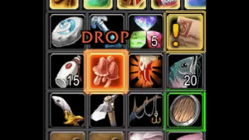
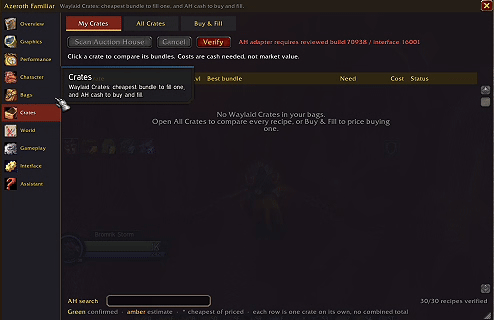
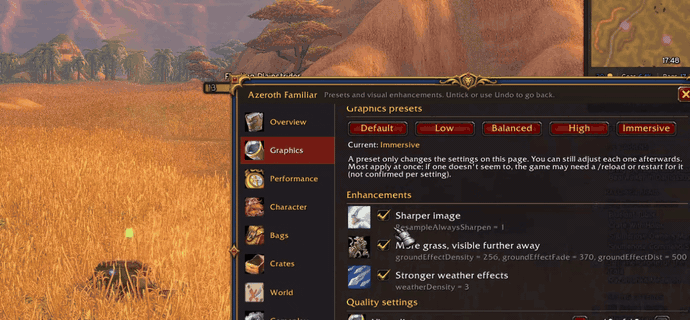
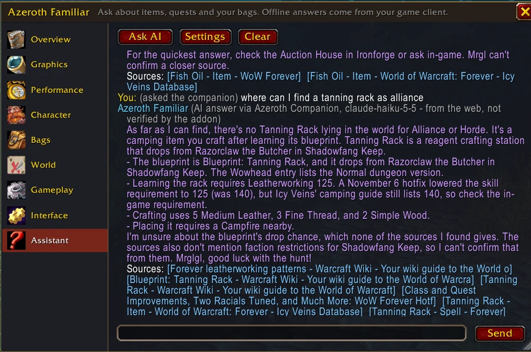
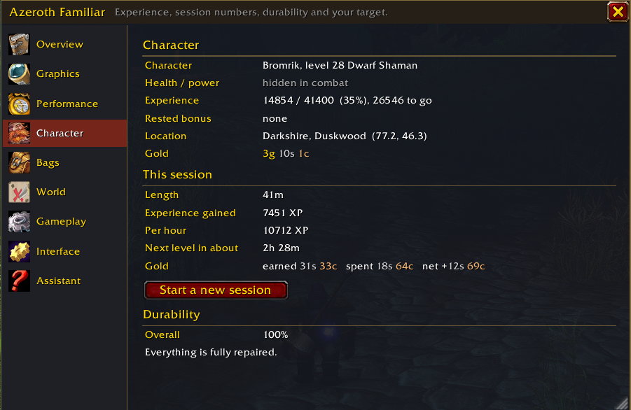

<!--
  CurseForge description for Azeroth Familiar. Paste everything below this comment into the
  project description (Markdown editor).

  MEDIA SLOTS: each "> 🎬" line marks a spot for a GIF or video.
  - GIF: save it in the repo's screenshots/ folder under the suggested name and push it to
    GitHub. Then delete the "> 🎬" line and remove the comment marks around the image line
    below it. The image loads from GitHub.
  - Video: upload to YouTube, then replace the "> 🎬" video line with the YouTube link (or use
    CurseForge's own "insert video" button there).
  Delete any "> 🎬" line you haven't filled before publishing, so visitors don't see it.
-->

# Azeroth Familiar

**Your all-in-one sidekick for World of Warcraft: Forever.** One window for everything you reach for every session: graphics presets, XP per hour, a "what do I drop?" helper for full bags, a Waylaid Crate planner with live auction prices, and an assistant that answers item and quest questions in plain English.

*Formerly Azeroth Assistant.*

> 🎬 **Video slot: 30-second tour** (open the window, flip through the pages). Paste the YouTube link here.

## 🎒 Bags full? Know what to drop
When you loot with full bags, the cheapest stack in your bags gets a pulsing red **DROP** label, your bags open so you can see it, and its tooltip says what it's worth.

- "Cheapest" uses the vendor price, or the **Auctionator** price when that is higher, so ore and herbs that sell well aren't picked
- Never picks quest items, your hearthstone, or profession tools like your skinning knife, mining pick or fishing pole
- Works with the default bags and **Bagnon**
- It only points: it never sells or deletes anything

## 📦 Waylaid Crates: the cheapest way to fill each crate
- **My Crates:** the crates in your bags, with materials you already own counted. A crate you can fill right now shows **Ready to fill · 0c**
- **All Crates:** every known recipe, cheapest first, with level requirements
- **Buy & Fill:** what an empty crate plus its materials costs in total
- **Scan Auction House:** one click with the AH open prices every bundle from live listings (or Auctionator's cached prices)
- **Tooltip highlight:** hover a crate and its cheapest bundle turns **green** (amber when it's only an estimate)
- Never buys, opens or fills anything for you

## 🎨 One-click graphics presets, with undo
- Five presets: **Default, Low, Balanced, High, Immersive**
- Three extras: **sharper image**, **more grass further away**, **stronger weather**
- The game's quality sliders with simple – / + buttons; each learns this client's real maximum
- Your original settings are remembered, and one button puts them all back

## 💬 Ask in plain English
- "is this an upgrade?" with an item link: stat differences against what you're wearing
- "which is better for me?" with two item links: a side-by-side comparison
- "where can I get [item]?": vendors, drops and quest rewards with coordinates (uses **Questie**)
- a quest link plus "where do I go?": objectives, progress, quest giver and turn-in
- its own **Assistant chat tab**, which never posts to public chat

Every answer says where it came from. Answers with web sources, like the one below, come from the optional **Azeroth Companion** desktop app, which is separate from this download.

> 🎬 **GIF slot: Assistant** (type "where can I get Linen Cloth?" and the answer appears). File: `screenshots/assistant.gif`
<!--  -->

## 📈 Character and session
XP and time to next level, **XP per hour**, rested bonus, gold earned / spent / net this session, and durability per item. The Overview card shows your health and mana in colour and a portrait matching your race and gender.

## ✨ Also included
- **World:** coordinates, saved places, and a map pin where the game supports it
- **Gameplay:** the game's own convenience options in one place: auto-loot, instant quest text, nameplates, camera distance, UI scale and more

  
- **Performance:** frame rate, latency, plain-language tips and an optional on-screen FPS readout
- **Reminders:** optional one-line chat notes for low durability, nearly full bags, vendor greys and repair cost, and a level-up summary with XP per hour
- **A proper frame:** gold and gem border around the window and its dialogs

## ⌨️ Commands
- `/fam`: open or close the window (`/familiar` works too)
- `/fam bags`, `/fam crates`, `/fam graphics`, `/fam world` …: jump straight to a page
- `/fam <question>`: ask from chat
- `/fam pin <name>`: save where you're standing
- `/fam help`: all commands

You can also click the minimap button or use the AddOn compartment menu.

## 🛡️ Safe by design
- **No automation.** It never sells, buys, repairs, loots, casts, targets or sends messages for you
- Game settings change only when you click, never in combat
- The addon itself never connects to anything and needs no account or API key
- Character details are never shared unless you turn sharing on, and even then never your name, realm or guild

## 🤝 Works with (all optional)
- **Questie:** vendor, drop, NPC and quest-location answers
- **Auctionator:** auction prices for the DROP mark and cached crate prices
- **Bagnon:** the DROP mark shows in Bagnon's bags

Made for **World of Warcraft: Forever**. Open source (MIT): https://github.com/xdsliperz1830-eng/azeroth-familiar
Feedback and bug reports are welcome; BugSack error text helps a lot.
