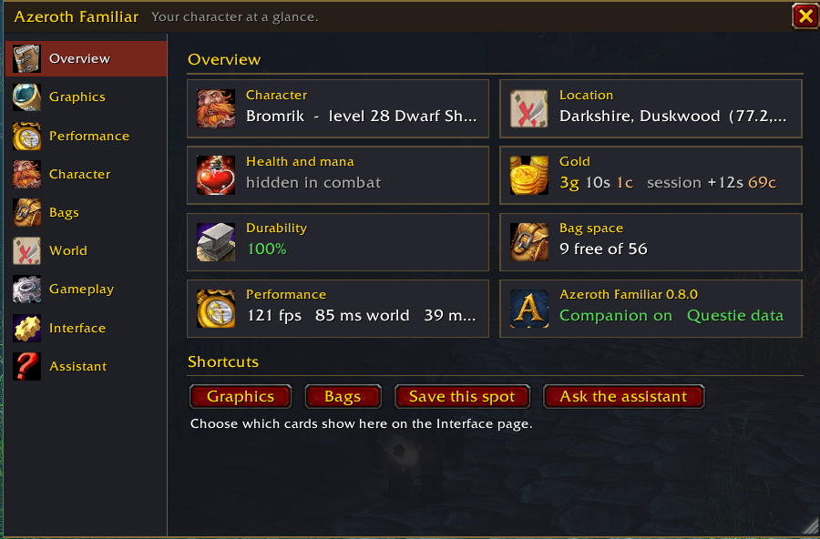
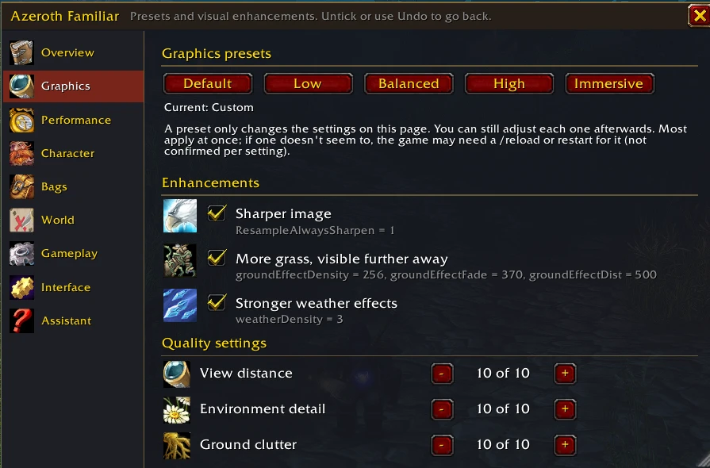
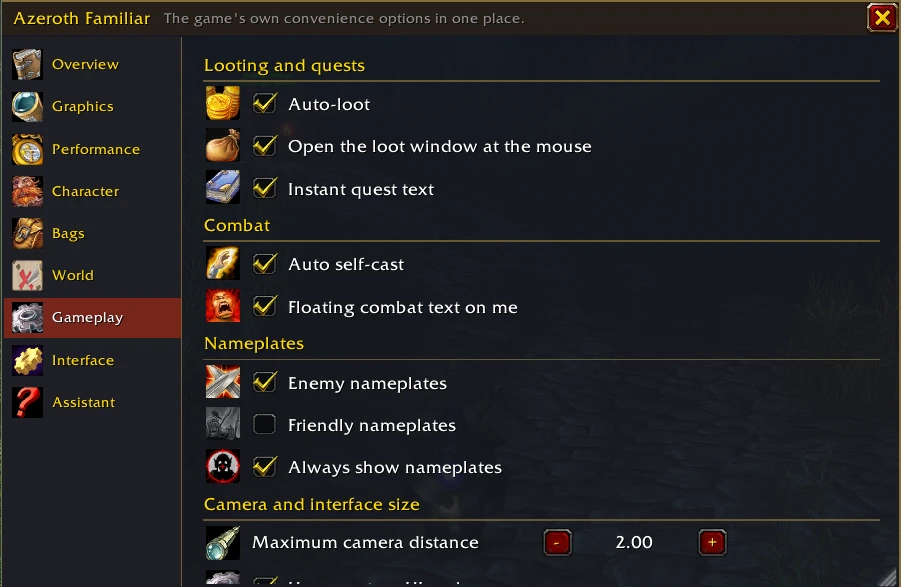

# Azeroth Familiar

**Your all-in-one sidekick for World of Warcraft: Forever.** One tidy window with everything you reach for every session, plus a helper that answers your item and quest questions right in game.

*Formerly Azeroth Assistant.*

## Overview: your character at a glance
Cards for your character (with a portrait that matches your race and gender), location and coordinates, health and mana, gold and this session's earnings, durability, bag space, frame rate and latency. Shortcut buttons take you straight to Graphics, Bags, saving your current spot, or the assistant. Choose which cards show on the Interface page.

## Graphics: one-click presets

- Five presets: **Default, Low, Balanced, High, Immersive**
- Three enhancements: **sharper image**, **more grass, visible further away**, **stronger weather effects**
- The game's quality sliders (view distance, environment detail, ground clutter and more) with simple – / + buttons
- Your original settings are remembered, and one button puts them all back

## Character: XP, session and durability

Experience and how much is left, rested bonus, location and gold. The **This session** block shows play time, XP gained, **XP per hour** and **time to next level**, plus gold earned, spent and net. Start a new session whenever you like. Durability is listed per item when anything needs repair.

## Gameplay: the game's convenience options in one place

Auto-loot, loot window at the mouse, instant quest text, auto self-cast, floating combat text, enemy and friendly nameplates, always-show nameplates, maximum camera distance, UI scale and more. Options this client doesn't have are greyed out.

## Bags: know what to drop
- Free slots, grey items and what they're worth at a vendor, and a bag search
- **Looting with full bags?** The cheapest stack in your bags gets a pulsing red **DROP** label. Cheapest means vendor price, or the auction price when **Auctionator** has one and it's higher, so items that sell well at the auction house aren't picked, its tooltip says to drop it, and the bags open so you can see it. Works with the default bags and **Bagnon**.
- It never picks quest items, your hearthstone, or profession tools like your skinning knife, mining pick or fishing pole

## Assistant: ask in plain English

- "is this an upgrade?" with an item link: stat differences against what you're wearing
- "which is better for me?" with two item links: a side-by-side comparison
- "search my bags for Medium Leather"
- a quest link plus "where do I go?": objectives, progress, and quest giver and turn-in locations
- "where can I get [item]?": vendors, drops and quest rewards with coordinates (needs Questie)
- clickable Wowhead links, and its own **Assistant chat tab** that never posts to public chat

Every answer says where it came from. AI answers with web sources, like the one above, come from the optional **Azeroth Companion** desktop app, which is separate from this download. Without it, the assistant answers from your game client and Questie.

## Also included
- **World:** coordinates, saved places, and a map pin where the game supports it
- **Performance:** frame rate, latency, plain-language tips and an optional on-screen FPS readout
- **Reminders:** optional one-line chat notes for low durability, nearly full bags, vendor greys and repair cost, and a level-up summary with XP per hour

## Commands
- `/fam`: open or close the window (`/familiar` works too)
- `/fam bags`, `/fam graphics`, `/fam world` …: jump straight to a page
- `/fam <question>`: ask from chat
- `/fam pin <name>`: save where you're standing
- `/fam help`: all commands

You can also click the minimap button or use the AddOn compartment menu.

## Safe by design
- **No automation.** It never sells, buys, repairs, loots, casts, targets or sends messages for you.
- Game settings change only when you click, never in combat.
- The addon itself never connects to anything and needs no account or API key.
- Character details are never shared unless you turn sharing on, and even then never your name, realm or guild.

## Works with
- **Questie** (optional): powers the vendor, drop, NPC and quest-location answers
- **Bagnon** (optional): the DROP mark shows in Bagnon's bags
- **Auctionator** (optional): auction prices count when choosing what to drop

Made for **World of Warcraft: Forever**. Source code: https://github.com/xdsliperz1830-eng/azeroth-familiar
Feedback and bug reports are welcome; BugSack error text helps a lot.
